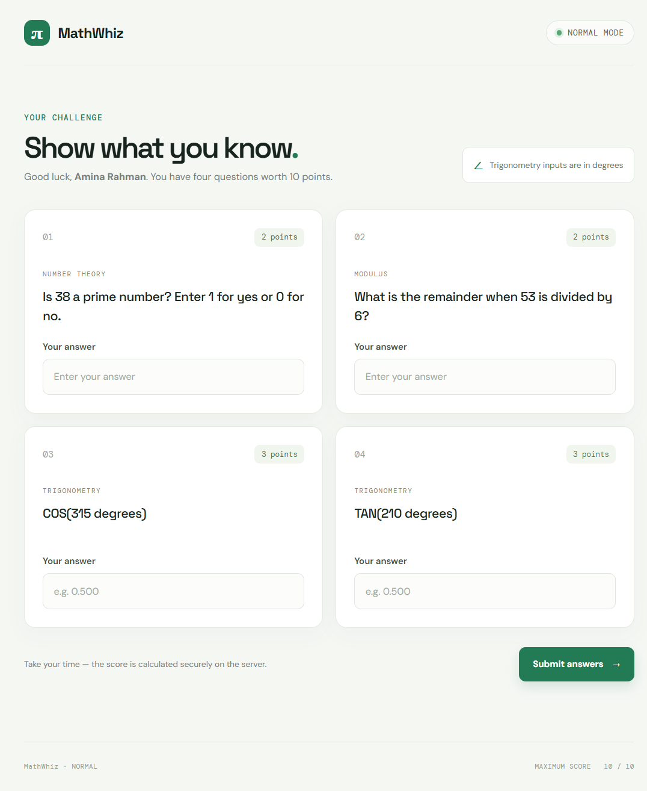
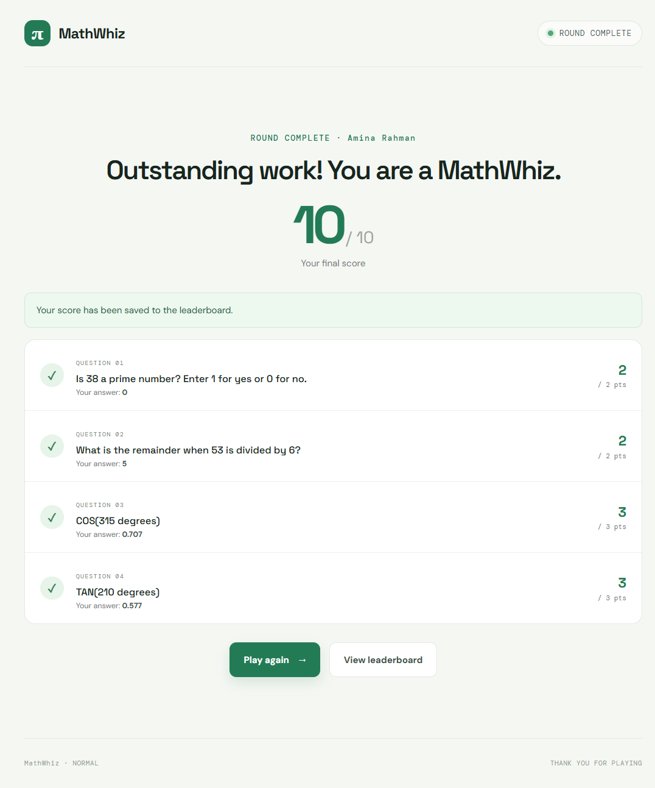
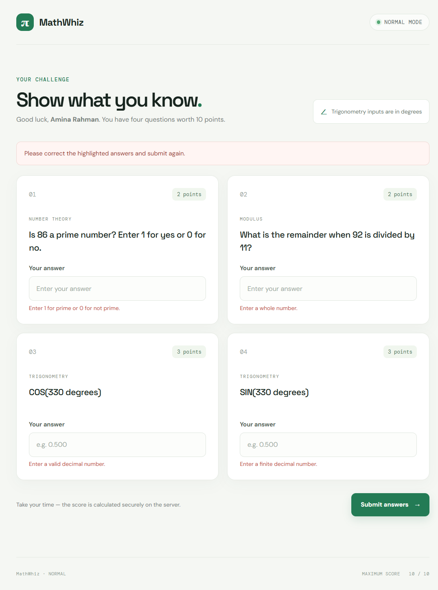

# Sadia Kabir Mou – MathWhiz

A server-rendered mathematics quiz application for the **Java Web Application Development — Live Lab Test #2** at the Department of ICT, MBSTU. Players answer four randomly generated questions, receive a server-calculated score out of 10, and can compare saved results on the MySQL-backed top-10 leaderboard.

## Learning objectives

- Build a small MVC web application with Jakarta Servlets and JSP.
- Use an HTTP session to preserve server-generated quiz questions between requests.
- Implement reusable mathematical methods and validate submitted data on the server.
- Persist application data with JDBC, prepared statements, and MySQL.
- Render dynamic, escaped JSP content and create responsive pages.

## Features

- Four randomly generated number-theory and trigonometry questions in NORMAL difficulty.
- Java calculations for primality, modulus, sine, cosine, and tangent.
- 2 + 2 + 3 + 3 point scoring, with a 0.001 tolerance for trigonometry.
- Per-answer validation and a breakdown of earned and possible marks.
- A database-backed leaderboard sorted by score descending and completion time ascending.
- Duplicate POST/refresh protection using a session result and Post/Redirect/Get.
- Parameterized SQL, escaped JSP output, and environment/system-property database configuration.

## Technologies and requirements

| Component | Version / requirement |
|---|---|
| Java | OpenJDK 27 |
| Maven | 3.9+ |
| Apache Tomcat | 11.0.x |
| Servlet / JSP | Jakarta Servlet 6.1 and JSP 4.0 |
| Database | MySQL 8.x (also compatible with MySQL 8.4) |
| Browser | Current desktop or mobile browser |

The inspected environment has OpenJDK 27, Maven 3.10.0, Tomcat 11.0.27, and MySQL Server 8.4.9. Java 26 is also on the default `PATH`, so set `JAVA_HOME` and `PATH` to JDK 27 before building. The Maven compiler targets Java 27. Deployment and database-backed game flow were verified using an isolated temporary Tomcat/MySQL instance.

## Project architecture

The application follows a small MVC structure:

- `controller/GameServlet` handles game start, answer submission, results, and leaderboard requests.
- `service/MathService` contains the required reusable mathematical operations; `GameService` generates and evaluates a round.
- `model` contains quiz, result, and score objects.
- `dao/ScoreDAO` performs database operations through `util/DBConnection`.
- JSP files render the welcome, quiz, result, and leaderboard views.

## Folder structure

```text
MathWhiz/
├── database/
│   └── math_whiz_db.sql
├── screenshots/
│   └── README.md
├── src/
│   ├── main/
│   │   ├── java/com/mathwhiz/
│   │   │   ├── controller/
│   │   │   ├── dao/
│   │   │   ├── model/
│   │   │   ├── service/
│   │   │   └── util/
│   │   └── webapp/
│   │       ├── css/style.css
│   │       ├── WEB-INF/web.xml
│   │       ├── game.jsp
│   │       ├── index.jsp
│   │       ├── leaderboard.jsp
│   │       └── result.jsp
│   └── test/java/com/mathwhiz/service/
├── .gitignore
└── pom.xml
```

## Mathematical functions

`com.mathwhiz.service.MathService` supplies the required static operations:

- `isPrime(int)` returns `1` for prime values and `0` otherwise, checking divisors up to the square root without overflowing.
- `calculateMod(int, int)` returns the Java remainder and throws `IllegalArgumentException` for a zero divisor.
- `calculateSin(double)`, `calculateCos(double)`, and `calculateTan(double)` accept degrees and convert them with `Math.toRadians()`. Tangent rejects angles whose cosine is effectively zero; non-finite angles are rejected.

The game service uses these methods to calculate expected results on the server. It never trusts a score or answer from the browser.

## Game rules and scoring

There are exactly four questions per round:

| Question | Topic | Marks |
|---|---|---:|
| 1 | Prime number (enter 1 or 0) | 2 |
| 2 | Integer modulus | 2 |
| 3 | Random SIN, COS, or TAN | 3 |
| 4 | Random SIN, COS, or TAN | 3 |
| **Total** | | **10** |

Trigonometric angles are shown in degrees and answers are checked with an absolute tolerance of 0.001. Tangent questions are generated only for defined angles. The generated question parameters stay in the HTTP session and are not regenerated during submission.

## Database setup

Create the schema and table using MySQL Workbench or the MySQL command-line client:

```sql
CREATE DATABASE IF NOT EXISTS math_whiz_db
    CHARACTER SET utf8mb4
    COLLATE utf8mb4_unicode_ci;

USE math_whiz_db;

CREATE TABLE IF NOT EXISTS game_scores (
    id INT PRIMARY KEY AUTO_INCREMENT,
    player_name VARCHAR(100) NOT NULL,
    score INT NOT NULL,
    difficulty VARCHAR(20) NOT NULL,
    played_at TIMESTAMP DEFAULT CURRENT_TIMESTAMP
);
```

The same script is available at [`database/math_whiz_db.sql`](database/math_whiz_db.sql).

### JDBC configuration

`DBConnection` reads configuration in this order: Java system property, environment variable, then the documented default.

| Java system property | Environment variable | Default |
|---|---|---|
| `mathwhiz.db.url` | `MATHWHIZ_DB_URL` | `jdbc:mysql://localhost:3306/math_whiz_db?useSSL=false&allowPublicKeyRetrieval=true&serverTimezone=UTC` |
| `mathwhiz.db.user` | `MATHWHIZ_DB_USER` | `root` |
| `mathwhiz.db.password` | `MATHWHIZ_DB_PASSWORD` | empty |

Set the environment variables for the account running Tomcat. For example, in PowerShell (replace the example password locally; do not commit it):

```powershell
$env:MATHWHIZ_DB_USER = "mathwhiz_app"
$env:MATHWHIZ_DB_PASSWORD = "your-local-password"
```

For production or shared environments, create a restricted MySQL account rather than using `root`. Never put a real password in source control. Database failures are logged by the servlet and are shown as clear user-facing messages.

## VS Code and Java setup

1. Install OpenJDK 27 as specified for the lab.
2. Set `JAVA_HOME` to the JDK installation directory and add `%JAVA_HOME%\bin` to `PATH`.
3. Install Apache Maven 3.9+ and verify with `mvn -version`.
4. In VS Code, install **Extension Pack for Java**. Open the MathWhiz folder and allow Maven dependencies to load.
5. Check Java with `java -version` and confirm it reports version 27.

## Tomcat 11 setup

1. Install Apache Tomcat 11.0.x from the official Apache Tomcat download site.
2. Configure VS Code's **Community Server Connectors** extension, add the Tomcat 11 server, and point it at the installation directory. Alternatively, copy `target/MathWhiz.war` into Tomcat's `webapps` folder and start Tomcat with `bin\startup.bat`.
3. The application uses Jakarta Servlet/JSP APIs and is configured with `WEB-INF/web.xml`; no Spring or embedded container is used.
4. Open `http://localhost:8080/MathWhiz/`.

Tomcat 11.0.27 is installed locally (though not on the default `PATH`). The application was deployed and verified on a temporary Tomcat 11.0.27 instance using OpenJDK 27.

## Build, run, and test

From the project directory:

```powershell
$env:JAVA_HOME = "<path-to-jdk-27>"
$env:Path = "$env:JAVA_HOME\bin;$env:Path"
mvn clean test
mvn package
```

Deploy `target/MathWhiz.war` to Tomcat 11 as described above. Configure MySQL and JDBC credentials before using score persistence or the leaderboard. The welcome page and game can render without a database; score saving and leaderboard reads require MySQL.

The automated JUnit tests cover:

- Prime cases: 7, 8, 1, 2, and 0.
- Modulus examples and zero-divisor rejection.
- `sin(30°)`, `cos(60°)`, `tan(45°)`, and undefined tangent angles.
- Four-question generation, nonzero modulus divisor, the 10/2/4/0 scoring scenarios, and invalid answers.

Database-backed score insertion and leaderboard retrieval were verified against an isolated MySQL 8.4.9 instance. The top-10 cap and earlier-time-first ordering for tied scores were also exercised with more than 10 records.

## Leaderboard

The leaderboard reads actual saved rows from MySQL. The query sorts by `score DESC, played_at ASC` and limits output to 10 records. If no rows exist, the page displays an empty-state message. If MySQL is unavailable, the page displays an error instead of presenting static or fabricated scores.

## Application Screenshots

### 1. Welcome Page
File: screenshots/01-welcome-page.png

Description: Displays the application title, player name input and Start Game button.


### 2. Game Page
File: screenshots/02-game-page.png

Description: Displays all four generated mathematical questions and answer fields.



### 3. Result Page
File: screenshots/03-result-page.png

Description: Displays the player's name, individual question results and final score out of 10.



### 4. Leaderboard
File: screenshots/04-leaderboard.png

Description: Displays the top 10 players retrieved from the MySQL database.


### 5. Database Table
File: screenshots/05-database-table.png

Description: Displays the saved player records in the MySQL game_scores table.

**Not captured:** No MySQL GUI is available for this environment. After starting your configured database, open MySQL Workbench, connect to `math_whiz_db`, run `SELECT id, player_name, score, difficulty, played_at FROM game_scores ORDER BY played_at DESC;`, and save a genuine screenshot as `screenshots/05-database-table.png`.

### 6. Validation Example
File: screenshots/06-validation-example.png

Description: Demonstrates input validation, such as an invalid answer or zero divisor prevention.



**Capture status:** Five genuine browser screenshots were captured from the running application. Only the MySQL GUI screenshot is missing; no fake screenshots are included. See [`screenshots/README.md`](screenshots/README.md) for the manual capture steps.

## GitHub repository

Repository: [https://github.com/iammoubee/MathWhiz](https://github.com/iammoubee/MathWhiz)
Submission branch: [https://github.com/iammoubee/MathWhiz/tree/main](https://github.com/iammoubee/MathWhiz/tree/main)

The existing repository README was preserved in spirit and expanded into this project guide. Repository changes are only considered published after GitHub confirms the push.
